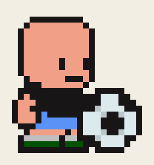
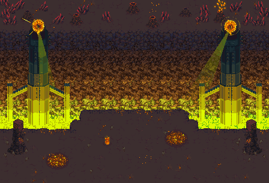
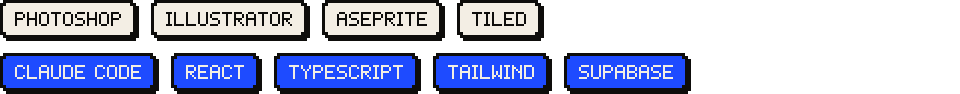

<div align="center">
  
</div>

> ### *I learned this job by shipping it — not by studying it.*

Graphic designer and creative director from Mongolia with five-plus years of shipped brand work for startups. These days I build the product too: websites, web apps and the architecture behind them, made with AI and drawn with a designer's eye.


<table>
  <tr><td><b>Graphic design</b></td><td>Posters, key art, marks and the visual world a product lives in. The thing people screenshot.</td></tr>
  <tr><td><b>Marketing design</b></td><td>Launch kits, social systems, landing narratives, KOL packs. Creative that has to perform in a four-week window.</td></tr>
  <tr><td><b>Creative direction</b></td><td>Story, positioning, partnerships and craft, aligned so the brand doesn't look like one thing and sell like another.</td></tr>
  <tr><td><b>Pixel & character</b></td><td>Sprites, portraits, collection identity. Hands on in Aseprite, not just directed.</td></tr>
  <tr><td><b>Launch systems</b></td><td>Whitepapers, Gitbook, decks and the visual kit a drop actually ships with.</td></tr>
  <tr><td><b>Websites</b></td><td>Brand and portfolio sites that look exactly like the brand and load fast.</td></tr>
  <tr><td><b>Web apps</b></td><td>Full products with accounts, dashboards and editors, taken from idea to launch with AI.</td></tr>
  <tr><td><b>Architecture</b></td><td>Planning how an app fits together: pages, data, logins and background jobs, so it can grow without a rewrite.</td></tr>
</table>




```text
01  ADOPT     the brief walks in messy. I take it as it is.
02  LEARN     I sit in the mechanic until I can draw it.
03  SHIFT     if it's alive and it works, we redraw, then we spend.
04  DEVELOP   marks, surfaces, the kit a launch ships with.
05  BUILD     describe it to AI, squint like a designer, ship it.
```

<br clear="right" />








<p>
  <a href="https://michealbuilds.site"></a>
  <a href="https://x.com/MichealOnChain"></a>
  <a href="https://t.me/oxdmicheal"></a>
  <a href="https://www.linkedin.com/in/michealnumads"></a>
  <a href="mailto:decentralizedmicheal@gmail.com"></a>
</p>


